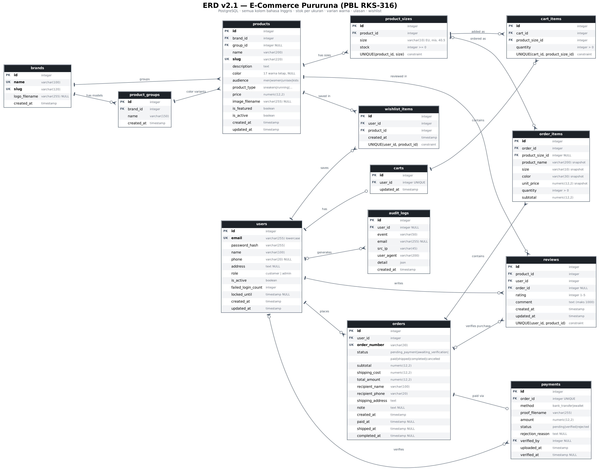
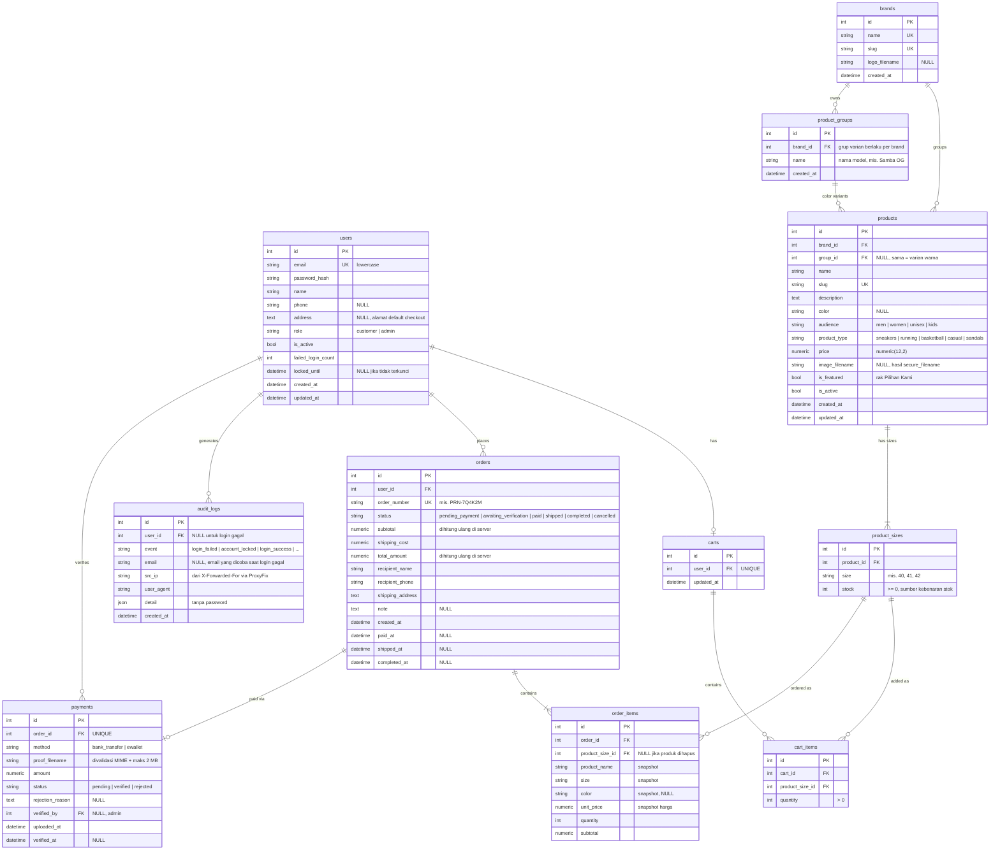

# ERD — E-Commerce Pururuna (PBL RKS-316) · v2

Dokumen desain basis data aplikasi e-commerce Flask, versi rombak (v2).
DBMS: PostgreSQL (dev: lokal WSL → produksi: srv-db 10.40.0.10, VLAN 40).

**Aturan penamaan:** semua nama tabel, kolom, dan nilai status dalam bahasa Inggris (snake_case).
Teks yang dilihat pengguna tetap bahasa Indonesia (diterjemahkan di template).

> Gambar `erd.png` belum memuat `product_groups.brand_id`; diagram mermaid di bawah adalah acuan terbaru.

---

## 1. Diagram

---

## 2. Perubahan dari v1

| Bagian | v1 | v2 | Alasan |
|---|---|---|---|
| Penamaan | campur (`nama`, `harga`, `alamat_kirim`) | semua Inggris (`name`, `price`, `shipping_address`) | seragam dengan event audit log dan rule Wazuh |
| `categories` | kategori umum | **`brands`** + `logo_filename` | di UI memang "Brand"; logo untuk rak Brand Populer |
| Stok | `products.stock` | **`product_sizes.stock`** per ukuran | sepatu dijual per ukuran |
| Varian warna | tidak ada | **`product_groups`** (milik satu brand) + `products.group_id`, `products.color` | detail produk menampilkan pilihan warna lain dari model yang sama |
| Filter katalog | hanya brand | + `audience`, `product_type`, `is_featured` | filter sidebar (untuk, jenis) dan rak Pilihan Kami |
| `cart_items` | per `product_id` | per **`product_size_id`** | keranjang menyimpan ukuran yang dipilih |
| `orders.status` | `pending/paid/...` | 6 status alur bukti bayar | sesuai desain Figma (menunggu bayar → menunggu verifikasi → dibayar → dikirim → selesai) |
| `orders` | `total_amount`, `alamat_kirim` | + `subtotal`, `shipping_cost`, data penerima, `paid_at`, `shipped_at`, `completed_at` | checkout, laporan transaksi, nota |
| `order_items` | snapshot nama + harga | + snapshot `size`, `color` | nota tidak berubah walau produk diedit/dihapus |
| `payments` | tanpa alasan tolak | + `rejection_reason`, `verified_at` | customer tahu kenapa ditolak; laporan waktu verifikasi |
| `users` | tanpa kontak | + `phone`, `address`, `updated_at` | profil dan isi otomatis checkout |
| `audit_logs` | `action`, `ip_address` | `event`, `email`, `src_ip`, `user_agent`, `detail` (JSON) | disamakan dengan kode audit log (PR #16) dan format log untuk Wazuh |

---

## 3. Keputusan desain penting

| Keputusan | Alasan |
|---|---|
| `order_items` menyimpan **snapshot** nama, ukuran, warna, harga | Riwayat pesanan dan nota tidak ikut berubah saat produk diedit atau dihapus. |
| `subtotal` dan `total_amount` **dihitung ulang di server** | Harga dari browser tidak pernah dipercaya. |
| `product_sizes.stock` satu-satunya sumber stok, dikurangi **saat checkout** dalam satu transaksi dengan `SELECT ... FOR UPDATE` | Mencegah stok minus saat dua user checkout bersamaan. |
| Stok total produk **dihitung**, tidak disimpan (`SUM(product_sizes.stock)`) | Tidak ada dua angka stok yang bisa saling beda. |
| `product_groups.brand_id` (FK `brands`, `ON DELETE CASCADE`); grup dicari berdasarkan (`brand_id`, `lower(name)`) | Model dengan nama sama dari brand berbeda (mis. "Classic") tidak tercampur sebagai varian warna. |
| Uang pakai `numeric(12,2)` | `float` menimbulkan error pembulatan. |
| `users.email` lowercase + `UNIQUE` | Mencegah dua akun dengan email beda huruf besar/kecil. |
| `failed_login_count` + `locked_until` di `users` | Penguncian akun bertahan antar worker Gunicorn. |
| `role` dicek di setiap route admin | Mencegah customer mengakses halaman admin. |
| Nilai `status`, `audience`, `product_type`, `method` divalidasi dengan **whitelist** di server + `CHECK` constraint | Nilai di luar daftar ditolak, baik dari form maupun dari URL. |
| `order_items.product_size_id` → `ON DELETE SET NULL` | Produk boleh dihapus tanpa merusak pesanan lama (snapshot tetap ada). |
| **Hapus akun = anonimisasi**, bukan hapus baris: `email` → `deleted-{id}@deleted.invalid`, `name` → "Akun dihapus", `phone`/`address` → NULL, password diacak, `is_active=False`, keranjang dihapus | Riwayat pesanan dan laporan tetap utuh (`orders.user_id` RESTRICT), data pribadi hilang. |
| Ganti password/email admin hanya lewat CLI server | Kalau sesi admin dibajak, penyerang tidak bisa mengambil alih akun lewat form web. |
| Detail audit log tidak pernah berisi password | Log dikirim ke Wazuh di soc-siem; password tidak boleh ikut. |

---

## 4. Constraint dan indeks

**Unique**
- `users(email)`, `brands(name)`, `brands(slug)`, `products(slug)`, `orders(order_number)`
- `carts(user_id)`, `payments(order_id)`
- `product_sizes(product_id, size)`
- `cart_items(cart_id, product_size_id)` — produk + ukuran yang sama menambah quantity, bukan baris baru

**Check**
- `product_sizes.stock >= 0`, `cart_items.quantity > 0`, `order_items.quantity > 0`
- `products.price >= 0`, `orders.total_amount >= 0`
- `orders.status IN (...)`, `payments.status IN (...)`, `users.role IN ('customer','admin')`
- `users.email = lower(email)`, `order_items.subtotal >= 0`

**Indeks**
- `products(brand_id)`, `products(group_id)`, `products(is_active, created_at)` — katalog dan rak beranda
- `product_groups(brand_id)` — cari grup varian per brand
- `orders(user_id, created_at)` — pesanan saya
- `orders(status, created_at)` — daftar pesanan admin, laporan
- `payments(status, uploaded_at)` — antrean verifikasi
- `order_items(order_id)`
- `audit_logs(event, created_at)` — filter log dan retensi 90 hari

---

## 5. Belum masuk (fitur nanti)

- Upload ulang bukti bayar setelah ditolak: **update baris `payments` yang sama** (ganti `proof_filename`, `status=pending`, `rejection_reason=NULL`, `uploaded_at=now`), jangan buat baris baru (`order_id` UNIQUE). Riwayat penolakan dicatat di `audit_logs`.

- `password_reset_tokens` (`user_id`, `token_hash`, `expires_at`, `used_at`) untuk lupa password customer — butuh SMTP.

---

## 6. Catatan migrasi

- v2 memakai **satu migrasi awal baru** (folder `migrations/` lama di-reset). Aman karena srv-db belum dibangun dari migrasi lama; database dev di laptop dibuat ulang.
- Data contoh diisi lewat perintah `flask seed`.
- Setelah v2, semua perubahan skema lewat Flask-Migrate: `flask db migrate -m "..."` → `flask db upgrade`.
- Jangan ubah tabel langsung lewat `psql`.
- Nama constraint mengikuti `naming_convention` di `extensions.py` (`pk_`, `fk_`, `uq_`, `ck_`, `ix_`).
