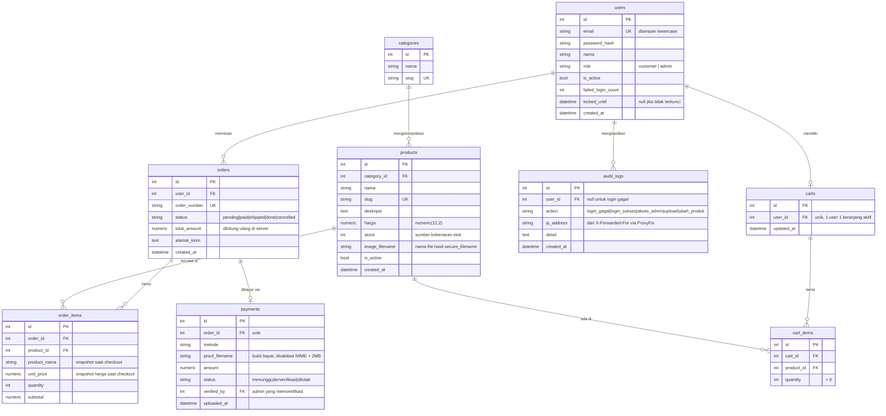

# ERD — E-Commerce srv-web (PBL RKS-316)

Dokumen desain basis data aplikasi e-commerce Flask.
DBMS: PostgreSQL (dev: lokal WSL → produksi: srv-db 10.40.0.10, VLAN 40).

---

## 1. Diagram

---

## 2. Keputusan desain penting

| Keputusan | Alasan |
|---|---|
| `order_items` menyimpan **snapshot** `product_nama` + `unit_price` | Kalau harga produk berubah/dihapus, riwayat pesanan lama tidak ikut berubah. Tanpa ini, nota pelanggan bisa berubah sendiri. |
| `total_amount` **dihitung ulang di server** saat checkout | Harga dan subtotal yang dikirim browser tidak pernah dipercaya (perbaikan dari Modul 3). |
| `products.stock` satu-satunya sumber stok, dikurangi **saat checkout** di dalam transaksi | Mencegah stok minus saat dua user checkout bersamaan. Pakai `SELECT ... FOR UPDATE`. |
| `harga` pakai `numeric(12,2)`, bukan `float` | `float` menimbulkan error pembulatan pada uang. |
| `users.email` disimpan lowercase + `UNIQUE` | PostgreSQL case-sensitive; tanpa ini `A@mail.com` dan `a@mail.com` jadi dua akun. |
| `failed_login_count` + `locked_until` di tabel `users` | Pembatasan brute force yang bertahan antar worker Gunicorn (rate limiter dict di Modul 6 tidak shared). |
| `role` sebagai kolom, dicek di middleware | Dasar pemeriksaan hak akses admin (cegah IDOR / akses admin oleh customer). |
| Tabel `audit_logs` terpisah | Sumber event untuk agen Wazuh ke soc-siem: login gagal, akses admin, upload. |
| `cart_items` unik per (`cart_id`, `product_id`) | Tambah produk yang sama menambah quantity, bukan baris baru. |

---

## 3. Indeks yang perlu dibuat

- `users(email)` — UNIQUE, dipakai tiap login
- `products(slug)` — UNIQUE, untuk URL detail produk
- `products(category_id)` — filter katalog
- `orders(user_id, created_at)` — riwayat pesanan user
- `order_items(order_id)` — tampil detail pesanan
- `audit_logs(created_at)` — pencarian log per rentang waktu

---

## 4. Catatan migrasi

- Semua perubahan skema lewat Flask-Migrate: `flask db migrate -m "..."` → `flask db upgrade`
- Jangan ubah tabel langsung lewat `psql` — skema di srv-db nanti dibangun dari folder `migrations/`
