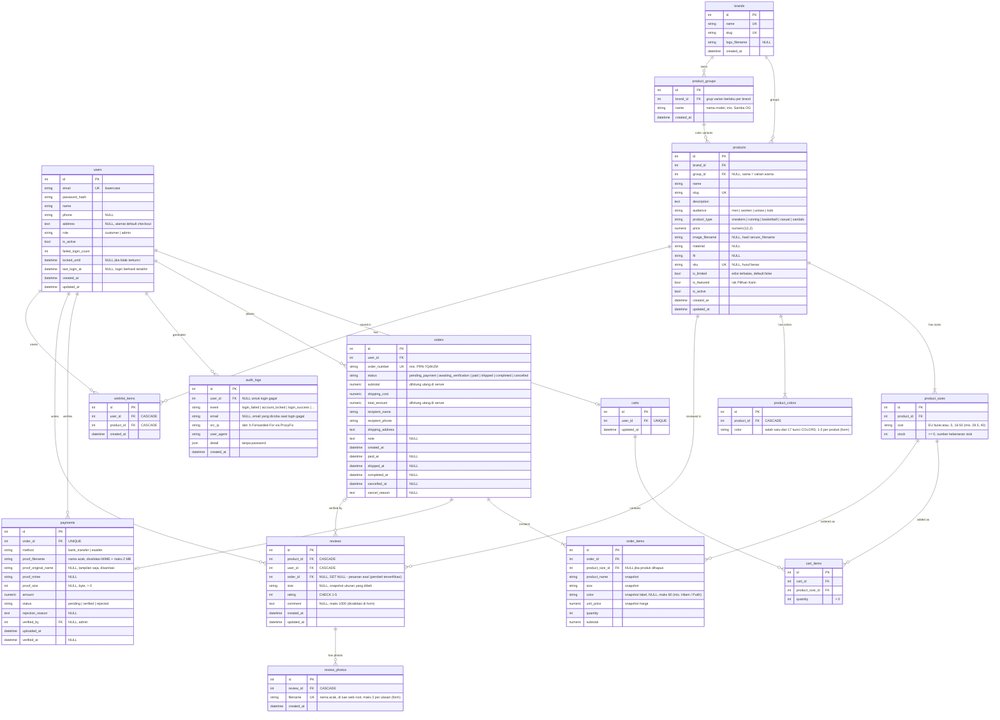

# ERD — E-Commerce Pururuna (PBL RKS-316) · v3

Dokumen desain basis data aplikasi e-commerce Flask, versi rombak (v2).
DBMS: PostgreSQL (dev: lokal WSL → produksi: srv-db 10.40.0.10, VLAN 40).

**Aturan penamaan:** semua nama tabel, kolom, dan nilai status dalam bahasa Inggris (snake_case).
Teks yang dilihat pengguna tetap bahasa Indonesia (diterjemahkan di template).

> Gambar `erd.png` = ERD v3 (15 tabel, termasuk perubahan #32; tabel/kolom berwarna biru = baru).

---

## 1. Diagram

---

## 2. Perubahan dari v1

| Bagian | v1 | v2 | Alasan |
|---|---|---|---|
| Penamaan | campur (`nama`, `harga`, `alamat_kirim`) | semua Inggris (`name`, `price`, `shipping_address`) | seragam dengan event audit log dan rule Wazuh |
| `categories` | kategori umum | **`brands`** + `logo_filename` | di UI memang "Brand"; logo untuk rak Brand Populer |
| Stok | `products.stock` | **`product_sizes.stock`** per ukuran | sepatu dijual per ukuran |
| Varian warna | tidak ada | **`product_groups`** (milik satu brand) + `products.group_id`, `products.color` | detail produk menampilkan pilihan warna lain dari model yang sama |
| Filter katalog | hanya brand | + `audience`, `product_type`, `is_featured` | filter sidebar (untuk, jenis) dan rak Pilihan Kami |
| `cart_items` | per `product_id` | per **`product_size_id`** | keranjang menyimpan ukuran yang dipilih |
| `orders.status` | `pending/paid/...` | 6 status alur bukti bayar | sesuai desain Figma (menunggu bayar → menunggu verifikasi → dibayar → dikirim → selesai) |
| `orders` | `total_amount`, `alamat_kirim` | + `subtotal`, `shipping_cost`, data penerima, `paid_at`, `shipped_at`, `completed_at` | checkout, laporan transaksi, nota |
| `order_items` | snapshot nama + harga | + snapshot `size`, `color` | nota tidak berubah walau produk diedit/dihapus |
| `payments` | tanpa alasan tolak | + `rejection_reason`, `verified_at` | customer tahu kenapa ditolak; laporan waktu verifikasi |
| `users` | tanpa kontak | + `phone`, `address`, `updated_at` | profil dan isi otomatis checkout |
| `audit_logs` | `action`, `ip_address` | `event`, `email`, `src_ip`, `user_agent`, `detail` (JSON) | disamakan dengan kode audit log (PR #16) dan format log untuk Wazuh |
| `products.color` (#30) | teks bebas ("Putih") | **17 kunci tetap** (`black`, `white`, …) + CHECK | filter Warna Figma 1.04 memakai daftar tetap dengan bulatan warna; ejaan tidak bisa beda |
| `product_sizes.size` (#30) | EU 2 digit | EU bulat **atau .5** (30–50) + CHECK | filter Ukuran Figma punya ukuran setengah |
| Ulasan & wishlist (#30) | tidak ada | tabel **`reviews`** dan **`wishlist_items`** | FR-005 (ulasan/rating) dan wishlist di desain |
| Warna (#32) | `products.color` (satu warna) | tabel **`product_colors`** (1–3 warna per produk); `products.color` dihapus | sepatu sering multi-warna (Figma 1.04 & 3.01); filter warna cukup cocok salah satu |
| `order_items.color` (#32) | `varchar(30)` | `varchar(60)` | snapshot label gabungan, mis. "Hitam / Kuning / Putih" |
| Spesifikasi (#32) | tidak ada | `products.material`, `fit`, `sku` (UNIQUE), `is_limited` | tabel spesifikasi di detail 3.01, form 2.03, koleksi "Edisi terbatas" |
| `product_sizes.size` (#32) | EU 30–50 | EU **16–50** (bulat atau .5) | ukuran anak |
| Ulasan (#32) | rating + komentar | + `reviews.size`, tabel **`review_photos`** | ulasan Figma 3.01 menampilkan ukuran yang dibeli dan foto |
| `payments` (#32) | hanya `proof_filename` | + `proof_original_name`, `proof_mime`, `proof_size` | info file untuk admin saat verifikasi |
| `orders` (#32) | tanpa data batal | + `cancelled_at`, `cancel_reason` | riwayat & kelola pesanan menampilkan alasan batal |
| `users` (#32) | — | + `last_login_at` | kelola user (4.06) menampilkan login terakhir |

---

## 3. Keputusan desain penting

| Keputusan | Alasan |
|---|---|
| `order_items` menyimpan **snapshot** nama, ukuran, warna, harga | Riwayat pesanan dan nota tidak ikut berubah saat produk diedit atau dihapus. |
| `subtotal` dan `total_amount` **dihitung ulang di server** | Harga dari browser tidak pernah dipercaya. |
| `product_sizes.stock` satu-satunya sumber stok, dikurangi **saat checkout** dalam satu transaksi dengan `SELECT ... FOR UPDATE` | Mencegah stok minus saat dua user checkout bersamaan. |
| Stok total produk **dihitung**, tidak disimpan (`SUM(product_sizes.stock)`) | Tidak ada dua angka stok yang bisa saling beda. |
| `product_groups.brand_id` (FK `brands`, `ON DELETE CASCADE`); grup dicari berdasarkan (`brand_id`, `lower(name)`) | Model dengan nama sama dari brand berbeda (mis. "Classic") tidak tercampur sebagai varian warna. |
| Uang pakai `numeric(12,2)` | `float` menimbulkan error pembulatan. |
| `users.email` lowercase + `UNIQUE` | Mencegah dua akun dengan email beda huruf besar/kecil. |
| `failed_login_count` + `locked_until` di `users` | Penguncian akun bertahan antar worker Gunicorn. |
| `role` dicek di setiap route admin | Mencegah customer mengakses halaman admin. |
| Nilai `status`, `audience`, `product_type`, `method`, `color` divalidasi dengan **whitelist** di server + `CHECK` constraint | Nilai di luar daftar ditolak, baik dari form maupun dari URL. |
| **Warna = 17 kunci tetap** di `COLORS` (`models/product.py`): kunci Inggris → (label Indonesia, hex bulatan). Label/hex di template lewat filter `color_label` / `color_hex` | Satu sumber untuk form, filter katalog, bulatan warna, dan CHECK. `order_items.color` (snapshot) tidak diberi CHECK supaya nota lama tetap utuh walau daftar warna berubah. |
| **Warna produk di tabel `product_colors`** (#32), 1–3 per produk: minimal 1 & maksimal 3 dicek di **form**, UNIQUE (`product_id, color`) + CHECK whitelist di DB. Urutan = `id` (urutan disimpan) | Batas 3 adalah aturan tampilan, bukan integritas data, jadi tidak dipaksa trigger DB. Snapshot ke `order_items.color` berupa label gabungan (`Product.color_keys` → label). |
| `products.sku` UNIQUE tapi boleh NULL; kosong disimpan NULL, huruf besar | Banyak produk lama belum punya SKU; `""` akan bentrok di UNIQUE. SKU dobel ditolak dengan pesan "SKU sudah dipakai produk lain." (cek awal + tangkap `IntegrityError`). |
| `review_photos.filename` UNIQUE, file di luar web root; maks 3 foto per ulasan dicek di form | Aturan upload sama dengan bukti bayar (ekstensi + MIME + `secure_filename` + 2 MB, nama acak). |
| `payments.proof_original_name` hanya untuk tampilan | Nama asli dari browser tidak dipercaya: disanitasi, tidak pernah dipakai sebagai path file. |
| **Ukuran EU** bulat atau `.5`, 16–50 (#32; sebelumnya 30–50), disimpan sebagai teks (`"40.5"`); CHECK regex di PostgreSQL; diurutkan **sebagai angka** (`CAST(size AS NUMERIC)`) | `"40.5"` harus di antara `"40"` dan `"41"`; urutan string salah. |
| Konversi EU → US/UK = **fungsi `convert_size`** dengan tabel di kode (perkiraan, pria/unisex, EU 35–50), **tanpa tabel DB** | Hanya acuan tampilan untuk tab EU/US/UK; tiap brand punya tabel sendiri sehingga tidak layak disimpan sebagai data pasti. |
| `reviews`: satu user satu ulasan per produk (UNIQUE `user_id, product_id`), rating 1–5 (CHECK); `order_id` SET NULL | Ulasan bisa ditandai "pembeli terverifikasi" lewat pesanan asal. Hapus produk/user → ulasan ikut terhapus; hapus pesanan tidak menghapus ulasan. |
| `wishlist_items`: UNIQUE (`user_id, product_id`), CASCADE ke user & produk | Klik ♡ dua kali tidak membuat baris ganda; produk yang dihapus hilang dari wishlist. |
| Relasi ORM ke `reviews`/`wishlist_items` **satu arah** (dari anak saja) | Hapus produk/user lewat ORM tidak mencoba mengisi NULL di kolom NOT NULL; DB yang menjalankan CASCADE. |
| `order_items.product_size_id` → `ON DELETE SET NULL` | Produk boleh dihapus tanpa merusak pesanan lama (snapshot tetap ada). |
| **Hapus akun = anonimisasi**, bukan hapus baris: `email` → `deleted-{id}@deleted.invalid`, `name` → "Akun dihapus", `phone`/`address` → NULL, password diacak, `is_active=False`, keranjang dihapus | Riwayat pesanan dan laporan tetap utuh (`orders.user_id` RESTRICT), data pribadi hilang. |
| Ganti password/email admin hanya lewat CLI server | Kalau sesi admin dibajak, penyerang tidak bisa mengambil alih akun lewat form web. |
| Detail audit log tidak pernah berisi password | Log dikirim ke Wazuh di soc-siem; password tidak boleh ikut. |

---

## 4. Constraint dan indeks

**Unique**
- `users(email)`, `brands(name)`, `brands(slug)`, `products(slug)`, `orders(order_number)`
- `carts(user_id)`, `payments(order_id)`
- `product_sizes(product_id, size)`
- `cart_items(cart_id, product_size_id)` — produk + ukuran yang sama menambah quantity, bukan baris baru
- `reviews(user_id, product_id)`, `wishlist_items(user_id, product_id)` — satu ulasan / satu ♡ per user per produk
- `product_colors(product_id, color)`, `products(sku)` (NULL boleh banyak), `review_photos(filename)`

**Check**
- `product_sizes.stock >= 0`, `cart_items.quantity > 0`, `order_items.quantity > 0`
- `products.price >= 0`, `orders.total_amount >= 0`
- `orders.status IN (...)`, `payments.status IN (...)`, `users.role IN ('customer','admin')`
- `users.email = lower(email)`, `order_items.subtotal >= 0`
- `product_colors.color IN (17 kunci COLORS)`, `product_sizes.size ~ '^(1[6-9]|[2-4][0-9])(\.5)?$|^50$'` (EU 16–50)
- `payments.proof_size > 0` (NULL boleh)
- `reviews.rating BETWEEN 1 AND 5`

**Indeks**
- `products(brand_id)`, `products(group_id)`, `products(is_active, created_at)` — katalog dan rak beranda
- `product_groups(brand_id)` — cari grup varian per brand
- `orders(user_id, created_at)` — pesanan saya
- `orders(status, created_at)` — daftar pesanan admin, laporan
- `payments(status, uploaded_at)` — antrean verifikasi
- `order_items(order_id)`
- `audit_logs(event, created_at)` — filter log dan retensi 90 hari
- `reviews(product_id)` — daftar ulasan di detail produk; `wishlist_items(product_id)` — CASCADE saat produk dihapus
- `product_colors(product_id)`, `review_photos(review_id)` — muat warna/foto per produk/ulasan

---

## 5. Belum masuk (fitur nanti)

- Upload ulang bukti bayar setelah ditolak: **update baris `payments` yang sama** (ganti `proof_filename`, `status=pending`, `rejection_reason=NULL`, `uploaded_at=now`), jangan buat baris baru (`order_id` UNIQUE). Riwayat penolakan dicatat di `audit_logs`.

- `password_reset_tokens` (`user_id`, `token_hash`, `expires_at`, `used_at`) untuk lupa password customer — butuh SMTP.

---

## 6. Catatan migrasi

- v2 memakai **satu migrasi awal baru** (folder `migrations/` lama di-reset). Aman karena srv-db belum dibangun dari migrasi lama; database dev di laptop dibuat ulang.
- Data contoh diisi lewat perintah `flask seed`.
- Setelah v2, semua perubahan skema lewat Flask-Migrate: `flask db migrate -m "..."` → `flask db upgrade`.
- Jangan ubah tabel langsung lewat `psql`.
- Nama constraint mengikuti `naming_convention` di `extensions.py` (`pk_`, `fk_`, `uq_`, `ck_`, `ix_`).
- **Autogenerate Alembic tidak mendeteksi CHECK baru pada tabel yang sudah ada.** Migrasi seperti itu ditulis manual (contoh: `145edb7f0c9a_warna_dan_ukuran_produk.py`), dan data lama diubah **sebelum** CHECK ditambahkan.
- Migrasi #30 (berurutan): `145edb7f0c9a` warna & ukuran → `8e3ad3d08f2c` tabel `reviews` → `8b941dcf18fd` tabel `wishlist_items`.
- Migrasi #32 (berurutan, semua diperiksa manual):
  1. `bd25bcaae9cf` warna multi: buat `product_colors` → **salin** `products.color` yang tidak NULL → baru drop `products.color` + `ck_products_color`; `order_items.color` 30 → 60. Downgrade: `products.color` = warna pertama (warna ke-2/3 hilang), gagal jelas bila ada `order_items.color` > 30 karakter.
  2. `e11f2068a0a1` spesifikasi: `material`, `fit`, `sku` + `uq_products_sku`, `is_limited` (server_default false).
  3. `53dd3a62897c` ukuran 16–50: drop + create `ck_product_sizes_size`. Downgrade gagal jelas bila ada ukuran < 30.
  4. `7d41337a36aa` ulasan: `reviews.size`, tabel `review_photos`.
  5. `7937be7831c9` bukti bayar: `proof_original_name`, `proof_mime`, `proof_size` + `ck_payments_proof_size`.
  6. `2223765f89a7` pembatalan: `orders.cancelled_at`, `cancel_reason`.
  7. `dba83dd2874e` `users.last_login_at`.
